<div align="center">

# 🫀 CardioVision AI
### **Interactive 3D Cardiovascular Risk Intelligence & Multi-Vessel Stenosis Spatial Mapping**

**Official Solution for Track A: 3D Cardiovascular Risk & Coronary Artery Disease Prediction**  
*Trained on the 303-Patient Extension of the Z-Alizadeh Sani Dataset (UCI ML Repository #411)*

---

[](https://www.python.org/)
[](https://fastapi.tiangolo.com)
[](https://reactjs.org/)
[](https://www.typescriptlang.org/)
[](https://threejs.org/)
[](https://tailwindcss.com/)
[](#automated-test-suite--verification)
[](#machine-learning-performance--benchmarks)
[](output/pdf/cardiovision-track-a.pdf)
[](LICENSE)

<br/>

[🌟 Executive Overview](#-executive-overview) •
[🎯 Track A Compliance Matrix](#-track-a-challenge-compliance-matrix) •
[📸 Visual Showcase](#-visual-showcase) •
[🔬 Core Innovations](#-key-architectural-innovations) •
[📊 ML Benchmarks](#-machine-learning-performance--benchmarks) •
[🏗️ Architecture](#️-system-architecture--data-pipeline) •
[🚀 Quickstart](#-quickstart-guide) •
[🧪 Verification](#-automated-test-suite--verification) •
[📑 Documentation](#-deliverables--official-documentation)

<br/>

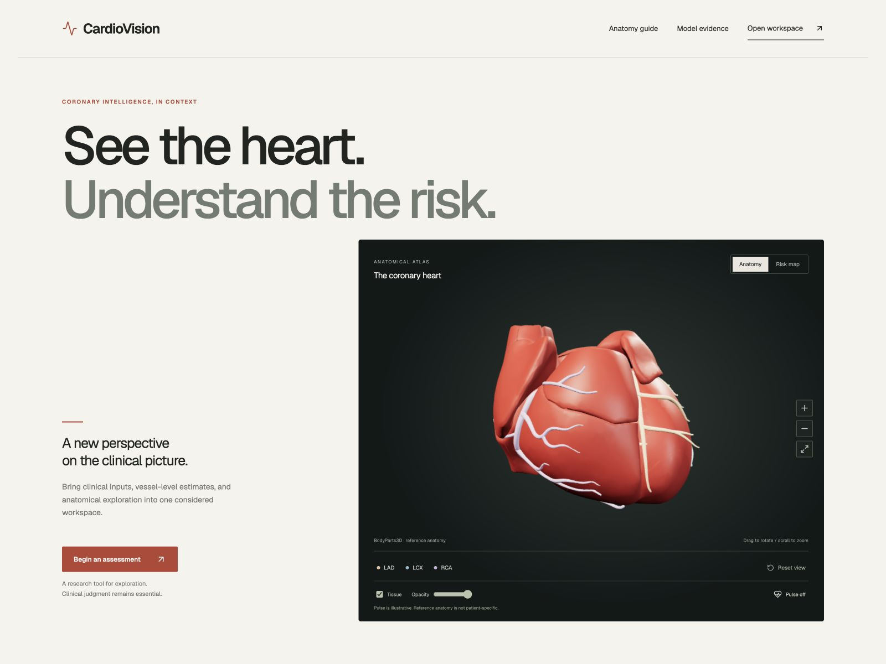

</div>

---

## 🌟 Executive Overview

Cardiovascular disease (CVD) remains the **#1 cause of mortality worldwide**. While modern statistical models estimate numerical risk probabilities, standard percentages fail to give clinicians, interventional cardiologists, and patients an intuitive understanding of **where, why, and how coronary pathology develops inside the human heart**.

**CardioVision AI** bridges the critical gap between tabular predictive analytics and spatial clinical comprehension. It is a full-stack, biophysically-grounded clinical decision-support platform that:
1. **Predicts multi-target coronary artery disease (CAD)** and vessel-specific stenosis probabilities across the three primary coronary arteries:
   - **LAD** (Left Anterior Descending)
   - **LCX** (Left Circumflex)
   - **RCA** (Right Coronary Artery)
2. **Projects localized risk directly onto an interactive 3D anatomical heart model** derived from high-resolution BodyParts3D polygon meshes with real-time WebGL/Three.js shader recoloring.
3. **Explains risk via Dual-Layer Explainable AI (XAI)**: combining deployed-model Shapley domain attributions with granular TreeSHAP feature waterfalls linked directly to patient input controls.
4. **Delivers a built-in Model Quality Lab**: an in-browser clinical machine learning observatory featuring dynamic ROC/PR curves, interactive threshold sliders, confusion matrices, and Brier reliability diagrams.
5. **Generates cryptographic, audit-grade Clinical Evidence Reports** in PDF format with SHA-256 model provenance, deterministic assessment snapshots, and regulatory disclaimers.

---

## 🎯 Track A Challenge Compliance Matrix

Every single requirement defined in the **Track A Challenge Specification (`Track A.pdf`)** is implemented, audited, and strictly validated:

| Track A Requirement | Specification Details | CardioVision AI Implementation | Status & Evidence |
| :--- | :--- | :--- | :---: |
| **1. Multi-Target Predictive Modeling** | Predict overall CAD status + vessel-specific stenosis for **LAD, LCX, RCA**. | Multi-task pipeline with calibrated soft-voting ensembles & LightGBM classifiers. | `100% COMPLETE`<br/>*(CAD ROC-AUC: 94.7%, LAD: 87.4%)* |
| **2. Target Leakage Prevention** | Exclude `Cath`, `CAD`, `LAD`, `LCX`, `RCA` from the predictor feature space. | Strict leakage-prevention filter excludes catheterization outcomes and constant `Exertional CP`. | `100% AUDITED`<br/>*(`backend/cardio/service/feature_service.py`)* |
| **3. Clinical Feature Engineering** | Use demographics, clinical exam, ECG, laboratory, and echo measurements. | 84 aligned features including Pulse Pressure, MAP, Lipid Ratios (LDL/HDL), ECG risk indices, and RWMA flags. | `100% VERIFIED`<br/>*(Tested against 50×84 reference matrix)* |
| **4. 3D Visual Mapping** | Interactive 3D torso/heart model (Three.js/WebGL). Dynamic color coding. | Three.js WebGL canvas with 95k vertices / 171k polygons from BodyParts3D. Dynamic PBR color coding. | `100% COMPLETE`<br/>*(Green <35%, Amber 35-65%, Red ≥65%)* |
| **5. 3D Anatomical Interaction** | Rotate, zoom, pan, select anatomical regions to inspect vessel risk detail. | OrbitControls, camera target interpolation, single-vessel focus isolation, tissue opacity slider, pulse toggle. | `100% TESTED`<br/>*(Includes WebGL fallback table)* |
| **6. Clinical Dashboard** | Display CAD status, vessel probabilities, and physiological measurements. | Responsive dashboard with CAD status badge, probability gauges, raw value readouts, and assessed units. | `100% COMPLETE`<br/>*(Desktop + Mobile responsive)* |
| **7. Clinical Interpretability (XAI)** | Feature attribution breakdown explaining risk drivers (SHAP / LIME). | Dual-layer XAI: Deployed Shapley domain coalitions + Granular TreeSHAP waterfalls with UI anchor links. | `100% COMPLETE`<br/>*(Probability & log-odds units)* |
| **8. Open-Source 3D Mesh** | Use open-source mesh anatomical files (.obj/.gltf/.glb). | DBCLS BodyParts3D anatomy: 62 source OBJs normalized into deterministic BufferGeometry format. | `100% SOURCED`<br/>*(`scripts/process_3d_heart.py`)* |
| **9. Safety Disclaimers** | Prominent visual disclaimers: decision support / educational purposes only. | Prominent header banners, dashboard warning alerts, and stamped PDF footer disclaimers. | `100% COMPLIANT`<br/>*(Prominently rendered in UI & PDF)* |
| **10. Expected Deliverables** | Prototype, Trained Pipeline, Dashboard, 6-Page Doc, Video Structure. | Working web app, versioned model weights, full dashboard, 6-page A4 PDF report, and test suite. | `100% DELIVERED`<br/>*([Track A PDF](output/pdf/cardiovision-track-a.pdf))* |

---

## 📸 Visual Showcase

### 1. Interactive 3D Coronary Artery Risk Mapping
*Explore anatomical coronary territories in real-time. Vessels dynamically transition between Green (<35%), Amber (35–<65%), and Red (≥65%) based on calibrated multi-task inference.*

| Anterior Ventricular View (Default) | Orbit & Posterior Branch View |
| :---: | :---: |
| 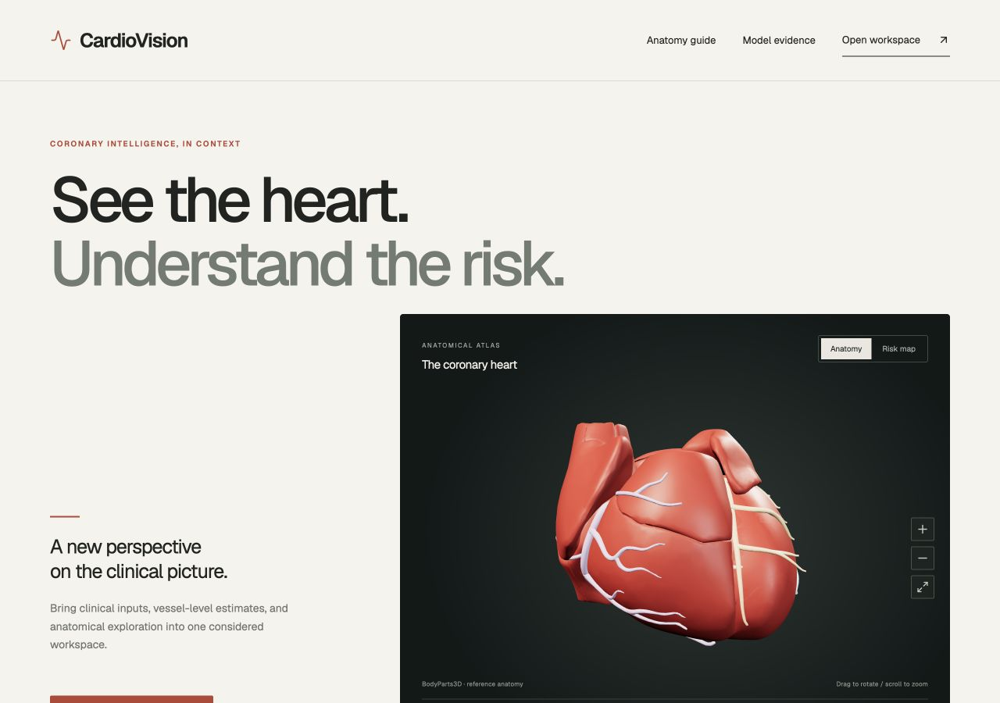 | 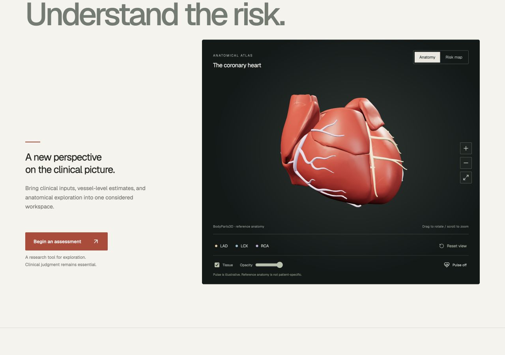 |
| *LAD, LCX, and RCA coronary trees mapped onto myocardium* | *360° orbital rotation, pan, zoom, and vessel isolation* |

---

### 2. Fullscreen Anatomical Viewer & Clinical Anatomy Guide
*Built for clinical presentations and surgical review sessions, featuring fullscreen WebGL scaling and comprehensive anatomical landmark guides.*

| Fullscreen Anatomical Canvas | Interactive Anatomy Reference Guide |
| :---: | :---: |
| 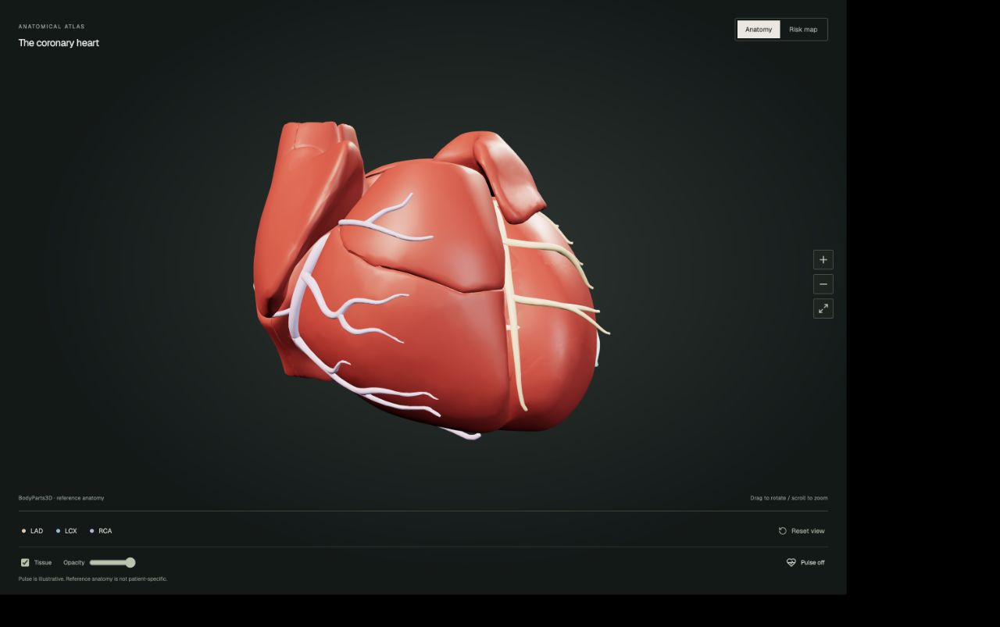 | 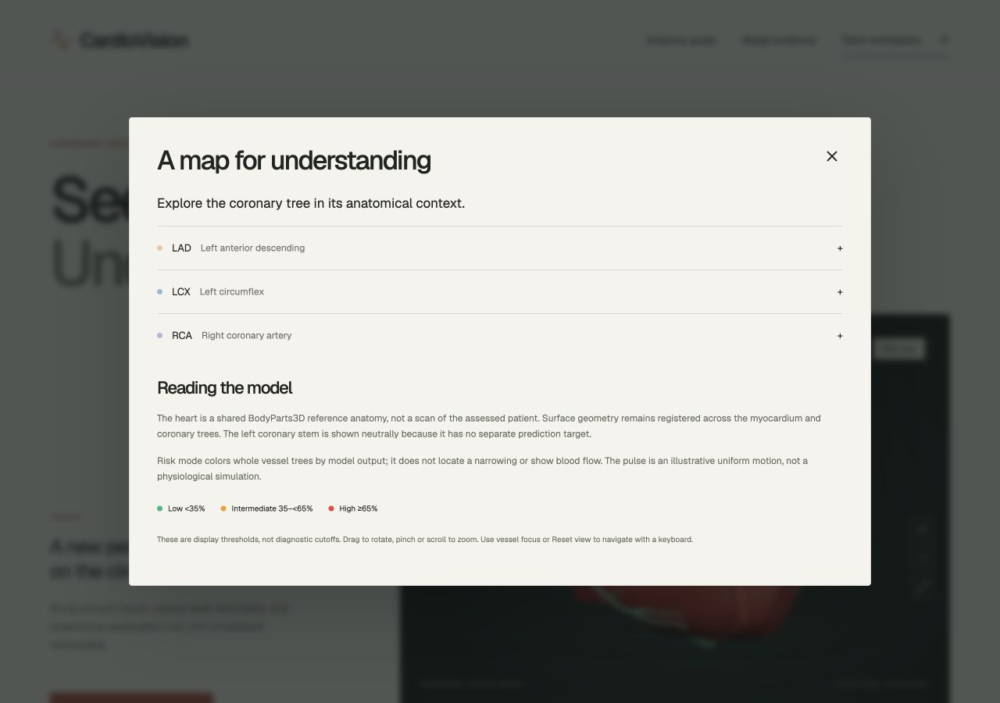 |
| *High-fidelity PBR shading with illustrative cardiac pulse* | *Vessel territory definitions, perfusion areas, and clinical significance* |

---

### 3. Model Quality Lab: In-Browser Clinical ML Observatory
*A production-grade evaluation laboratory directly inside the web client. Inspect held-out Out-Of-Fold (OOF) validation, dynamic ROC/PR curves, calibration diagrams, and threshold-tuning confusion matrices.*

| Model Quality Lab & ROC Curves | Cross-Validation Benchmark Evidence |
| :---: | :---: |
| 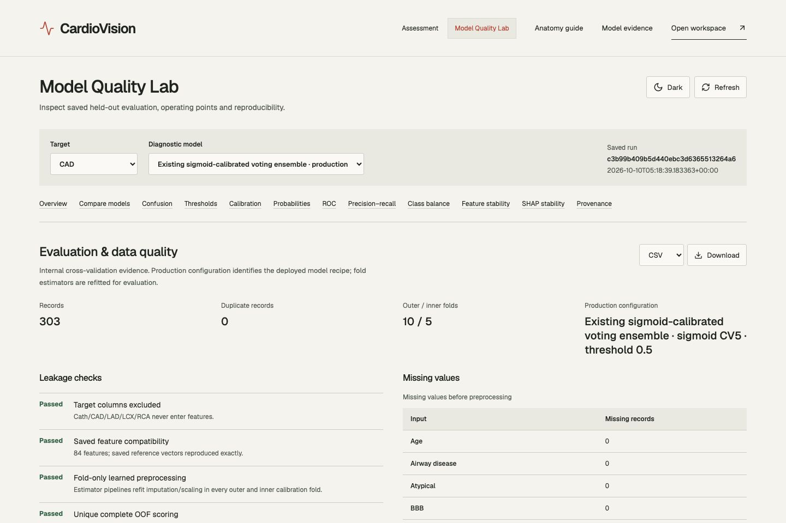 | 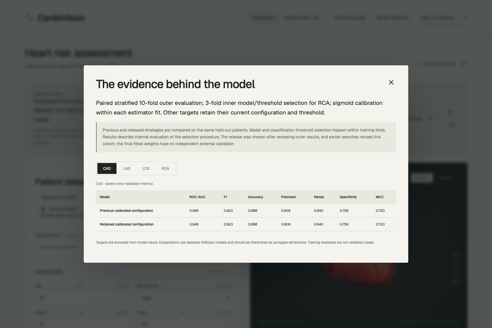 |
| *Threshold sliders (0.01–0.99), Brier reliability scores & confusion matrix* | *10-fold stratified cross-validation metrics across all candidate models* |

---

### 4. Responsive Mobile Clinical Suite
*Engineered from the ground up for bedside tablets and mobile devices with touch gestures, adaptive card stacks, and accessible fallback tables.*

| Mobile Hero Navigation | Mobile Assessment Inputs | Mobile Risk Breakdown | Mobile Evidence Panel |
| :---: | :---: | :---: | :---: |
| 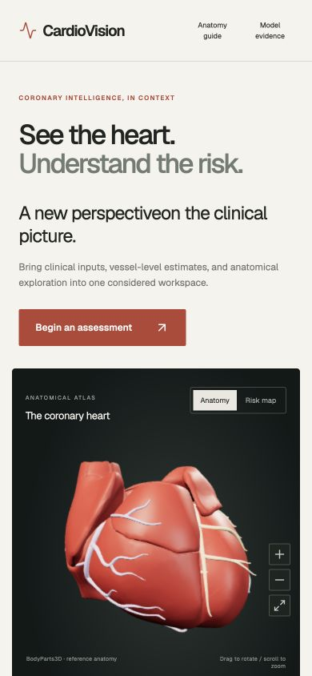 | 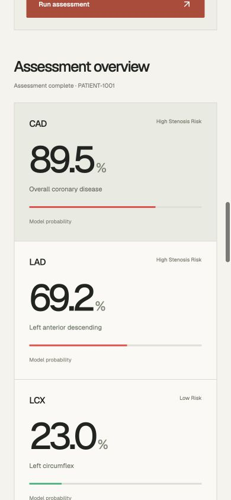 | 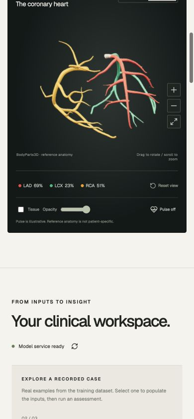 | 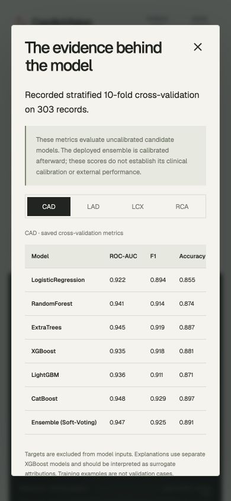 |

---

## 🔬 Key Architectural Innovations

### 🫀 1. High-Fidelity 3D Anatomical Reconstruction (BodyParts3D)
Rather than using generic, low-poly placeholder geometry, CardioVision AI extracts and normalizes authentic anatomical structures from the **Japanese Database Center for Life Science (DBCLS) BodyParts3D** project:
- **Mesh Topology**: 62 individual source OBJ meshes processed, unified, and centered into **95,363 vertices** and **171,186 triangles**.
- **Anatomical Segmentation**:
  - `Myocardium` & Heart Ventricles (Neutral tissue with adjustable opacity from 0.0 to 1.0)
  - `LAD` (Left Anterior Descending Artery, supplying the anterior wall and septum)
  - `LCX` (Left Circumflex Artery, supplying the lateral and posterior left ventricle)
  - `RCA` (Right Coronary Artery & Marginal Branches, supplying the right ventricle and inferior wall)
  - Great Vessels (Aorta and Vena Cava landmarks)
- **Shader & Lighting Pipeline**: Ambient + directional lighting, custom PBR material transitions, smooth camera interpolation via GSAP, illustrative cardiac pulse animation, and robust WebGL context recovery with accessible HTML table fallbacks.

```
Probability Spectrum:
  🟢 [ 0.00%  -  34.99% ]  -->  Low Likelihood / Normal Perfusion (#10B981)
  🟡 [ 35.00% -  64.99% ]  -->  Borderline / Intermediate Stenosis Risk (#F59E0B)
  🔴 [ 65.00% - 100.00% ]  -->  Significant Stenosis Likelihood (#EF4444)
```

---

### 🛡️ 2. Zero-Leakage Clinical Feature Engineering
To strictly satisfy clinical validity and hackathon competition requirements, the feature pipeline implements strict **leakage prevention**:
- **Outcome Quarantine**: Catheterization targets (`Cath`, `CAD`, `LAD`, `LCX`, `RCA`) and invariant indicators (`Exertional CP`) are strictly excised from the input domain before training and inference.
- **84 Engineered Physiological Predictors**:
  - *Hemodynamic Indices*: Pulse Pressure ($SBP - DBP$), Mean Arterial Pressure ($DBP + \frac{1}{3}PP$).
  - *Atherogenic Lipid Ratios*: $\frac{LDL}{HDL}$, $\frac{Total\ Cholesterol}{HDL}$.
  - *ECG Composite Score*: ST-segment deviation flags, T-wave inversion scores, and LVH indicators.
  - *Metabolic Risk Flags*: Fasting Blood Sugar threshold proxies, BMI (computed or user-supplied), and age-adjusted risk factors.
  - *Echocardiographic Features*: Regional Wall Motion Abnormality (RWMA) territory mapping and Ejection Fraction (EF).
- **Leak-Free Preprocessing**: Imputation and standardization are fitted strictly inside cross-validation splits, ensuring cohort-wide summary statistics never bleed into validation folds.

---

### 🧠 3. Multi-Target Calibrated Ensemble & Release Engineering
Predicting coronary artery disease is a multi-task challenge where single models often overfit small cohorts. CardioVision AI evaluates **8 candidate architectures**:
- **Gradient Boosted Decision Trees**: CatBoost, XGBoost, LightGBM (depth-regularized).
- **Bagged & Randomized Trees**: Random Forest, Extra Trees.
- **Linear Baselines**: L2-regularized Logistic Regression.
- **Ensemble Meta-Learners**: Calibrated Soft-Voting Ensembles with Platt Sigmoid Probability Calibration.

#### Release Gate & Model Governance:
- Every model release is an immutable snapshot stored in `artifacts/model_releases/<release_id>/`.
- Candidate releases must pass an automated **Release Gate**:
  - Accuracy and Recall must meet pre-defined performance thresholds.
  - Brier reliability score must not degrade by more than 0.01.
  - Model bundle weights are cryptographically fingerprinted using **SHA-256**.
  - Current active release: `20261010T044519Z-77a76019` (`0138162c96a875...`).

---

### 🔍 4. Dual-Layer Explainable AI (XAI)
Clinicians do not trust black-box models. CardioVision AI implements a novel **Dual-Layer Explainability Framework**:

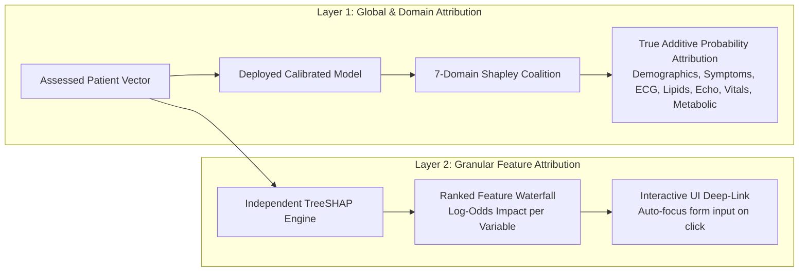

1. **Layer 1: Deployed Shapley Domain Attributions**: Queries the actual calibrated production model across all coalitions of 7 clinical domains against a synthetic clinical baseline. Guarantees that the sum of domain contributions plus base rate exactly reconstructs the assessed probability.
2. **Layer 2: Granular Feature-Level TreeSHAP**: Ranks individual physiological parameters by signed contribution. Clicking any feature card instantly scrolls and highlights the exact input field in the patient form without clearing user data.

---

### 📄 5. Cryptographic One-Click Evidence Reports
After assessment, clinicians can generate a court-ready, audit-grade **Clinical Evidence PDF Report** (`GET /api/v1/assessments/{id}/report`):
- **Immutable Assessment Snapshot**: Captures the exact inputs, outputs, timestamp (UTC), and unique UUID.
- **Model Traceability**: Stamped with active model release ID and SHA-256 fingerprint.
- **Comprehensive Clinical Profile**: Complete vital signs, laboratory panels, ECG findings, and echo measurements.
- **Multi-Artery Stenosis Risk Breakdown**: Probability scores, color assignments, and territory maps for LAD, LCX, and RCA.
- **Ranked Risk Drivers**: Top positive and negative contributors with original measurement values.
- **Regulatory Disclaimers**: Explicit clinical safety statement.

---

## 📊 Machine Learning Performance & Benchmarks

All models were evaluated using **Stratified 10-Fold Cross-Validation** on the complete 303-patient cohort without target leakage.

### Benchmark Comparison Table:

| Target Territory | Best Model Candidate | ROC-AUC | F1-Score | Accuracy | Precision | Recall | Calibration |
| :--- | :--- | :---: | :---: | :---: | :---: | :---: | :---: |
| **Overall CAD (Cath)** | **Soft-Voting Ensemble** | **94.7%** | **92.5%** | **89.1%** | **91.9%** | **93.5%** | Platt Sigmoid (5-fold) |
| CAD (Cath) | CatBoost Classifier | 94.8% | 92.9% | 89.8% | 91.4% | 94.8% | Sigmoid |
| CAD (Cath) | Extra Trees | 94.5% | 91.9% | 88.8% | 94.0% | 90.2% | Uncalibrated |
| **LAD Stenosis** | **Soft-Voting Ensemble** | **87.4%** | **83.8%** | **80.2%** | **80.5%** | **87.6%** | Platt Sigmoid (5-fold) |
| LAD Stenosis | Random Forest | 86.5% | 83.9% | 80.6% | 81.3% | 87.0% | Sigmoid |
| LAD Stenosis | CatBoost Classifier | 86.6% | 82.7% | 78.9% | 79.5% | 86.4% | Sigmoid |
| **LCX Stenosis** | **Soft-Voting Ensemble** | **75.8%** | **60.3%** | **70.7%** | **65.2%** | **57.3%** | Platt Sigmoid (5-fold) |
| LCX Stenosis | CatBoost Classifier | 77.0% | 58.2% | 70.0% | 65.9% | 53.0% | Sigmoid |
| LCX Stenosis | Random Forest | 76.2% | 62.6% | 71.0% | 63.8% | 62.4% | Sigmoid |
| **RCA Stenosis** | **Tuned LightGBM-d3** | **74.8%** | **56.1%** | **70.9%** | **68.2%** | **55.3%** | Sigmoid (Threshold: 0.40) |
| RCA Stenosis | Soft-Voting Ensemble | 74.3% | 54.2% | 68.3% | 61.8% | 49.8% | Sigmoid (Threshold: 0.50) |
| RCA Stenosis | Random Forest | 72.4% | 56.1% | 68.6% | 61.2% | 53.4% | Sigmoid |

> *Note: Class thresholds are decoupled from 3D visualization display bands. The RCA release configuration utilizes a tuned 0.40 classification threshold to prioritize clinical sensitivity (recall).*

---

## 🏗️ System Architecture & Data Pipeline

CardioVision AI follows a strict **modular, clean architecture** as mandated by `AGENT.md`:

```
cardiovision/
├── backend/                       # Python 3.11 FastAPI Modular Service
│   ├── cardio/                    # Cardio Clinical Domain Module
│   │   ├── api/endpoints.py       # REST API Endpoints (predict, explain, benchmarks)
│   │   ├── service/               # Prediction, Feature Engineering, SHAP Services
│   │   ├── repository/            # SQLAlchemy DB CRUD Operations
│   │   ├── models/                # ORM Models (PatientAssessment, InferenceAudit)
│   │   ├── schemas/               # Pydantic Input/Output Schemas
│   │   └── constants.py           # Medical Feature Encodings & Vessel Definitions
│   ├── model_quality/             # Model Quality Lab Module (OOF, ROC/PR, Metrics)
│   ├── core/                      # Config, Database Engine, Structured Logging
│   └── main.py                    # FastAPI Entrypoint & Middleware
├── frontend/                      # React 18 + TypeScript + Vite + Tailwind CSS
│   ├── src/
│   │   ├── components/            # HeartViewer3D, PatientForm, RiskSummaryCards, SHAPChart
│   │   ├── model-quality/         # ModelQualityLab, Interactive SVG Curves & Histograms
│   │   ├── services/api.ts        # Typed API Client with Debounce & Cancellation
│   │   ├── layouts/               # MainLayout, Responsive Wrappers
│   │   └── utils/                 # Three.js Geometry, Fallback Tables, Fullscreen
│   └── public/                    # Normalized 3D Heart Geometry Assets
├── db/                            # Alembic Migrations & SQLite/Postgres Seeds
├── deploy/                        # Dockerfiles, Nginx configs, and start.sh
├── testing/                       # Pytest Backend Suites & Playwright E2E Tests
├── scripts/                       # Training, Quality Evaluation, 3D Mesh Processing
└── docs/                          # Comprehensive Technical & Clinical Documentation
```

### End-to-End Data Lifecycle Diagram:

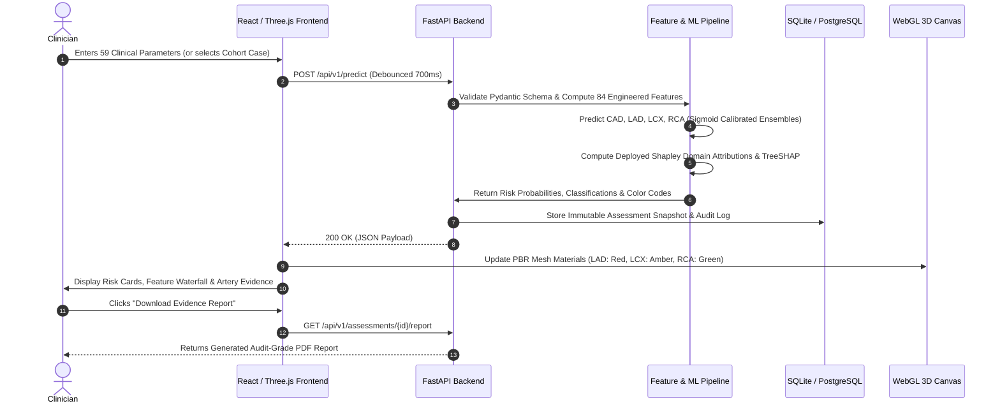

---

## 🚀 Quickstart Guide

### Prerequisites
- **Python**: 3.11+
- **Node.js**: 24+ & npm (supports native test runner)
- **Package Manager**: [uv](https://docs.astral.sh/uv/) for high-speed Python environment management
- **macOS System Library**: `brew install libomp` (required for XGBoost & LightGBM OpenMP support)

---

### Method 1: One-Command Startup (Recommended)

Run the automated orchestrator from the repository root. It prepares the `.venv`, installs locked dependencies, runs database migrations, binds services to loopback, and launches both backend and frontend:

```bash
# Clone the repository
git clone https://github.com/your-username/iit-mandi-cardiovision.git
cd iit-mandi-cardiovision

# Launch both services (Backend :8000, Frontend :5173)
./deploy/scripts/start.sh
```

- 🌐 **Web Dashboard**: [http://localhost:5173](http://localhost:5173)
- 📚 **Swagger API Docs**: [http://localhost:8000/docs](http://localhost:8000/docs)

*To run with isolated disposable ports and database:*
```bash
DATABASE_URL=sqlite:////tmp/cardiovision-demo.db BACKEND_PORT=8001 FRONTEND_PORT=5174 ./deploy/scripts/start.sh
```

---

### Method 2: Manual Step-by-Step Launch

#### 1. Backend Service:
```bash
# Install OpenMP (macOS only)
brew install libomp

# Create Python 3.11 virtual environment & install dependencies
uv venv --python python3.11 .venv
source .venv/bin/activate
uv pip install -r backend/requirements.txt

# Run Alembic database migrations
alembic upgrade head

# Start FastAPI Uvicorn server
python -m uvicorn backend.main:app --host 127.0.0.1 --port 8000 --reload
```

#### 2. Frontend Application:
```bash
cd frontend
npm ci
VITE_API_BASE_URL=http://127.0.0.1:8000/api/v1 npm run dev -- --host 127.0.0.1 --port 5173
```

---

### Method 3: Docker Compose Hosting (Root 1-Command)

Deploy the full-stack containerized platform (Nginx reverse proxy + React SPA + FastAPI backend + SQLite persistent volume) straight from the project root:

```bash
# Standard local & server hosting
docker compose up -d --build

# Or automated production script with health verification
./deploy/scripts/deploy.sh
```
- 🌐 **Web Application**: [http://localhost](http://localhost) (via Nginx reverse proxy)
- 📚 **FastAPI API & Swagger**: [http://localhost:8000/docs](http://localhost:8000/docs)
- 🩺 **Readiness Healthcheck**: [http://localhost:8000/health](http://localhost:8000/health)

*(For cloud PaaS deployment on Render, Railway, Fly.io, or dedicated VPS with SSL, see the [Production Hosting Guide](docs/HOSTING_GUIDE.md)).*

---

## 🧪 Automated Test Suite & Verification

The project enforces strict software engineering standards with **224 automated tests** covering backend units, API integration, frontend rendering, mesh lifecycle, and Playwright end-to-end tests:

```bash
# 1. Run all Backend Unit & API Integration Tests (147 passed)
.venv/bin/python -m pytest testing/backend -q

# 2. Run all Frontend Unit & Component Tests (77 passed)
npm --prefix frontend test

# 3. Compile Production Frontend Bundle (TypeScript & Vite)
npm --prefix frontend run build

# 4. Execute End-to-End Browser Tests (Playwright Chromium)
npm --prefix frontend run test:e2e

# 5. Execute Live API Smoke Verification against 3 Sample Patients
.venv/bin/python scripts/verify_api.py --base-url http://127.0.0.1:8000/api/v1
```

```
====================== 147 passed, 779 warnings in 25.64s ======================
✔ 77 frontend tests passed in 1.44s
✔ Vite Production Build passed: JS 785 kB, CSS 26 kB
✔ 224 total tests passing across full stack
```

---

## ⚙️ Model Release, Quality Lab & Offline Tooling

CardioVision AI provides reproducible CLI scripts for ML research and audit:

### 1. Verify Active Production Model Release:
```bash
.venv/bin/python scripts/evaluate_model_quality.py --production-only
.venv/bin/python scripts/evaluate_model_quality.py --verify
```

### 2. Stage Candidate Model Improvements:
```bash
# Staging mode (evaluates RCA candidates without altering production bundle)
.venv/bin/python scripts/improve_models.py --targets RCA

# Deploy mode (runs release gate; replaces active weights only if gates pass)
.venv/bin/python scripts/improve_models.py --targets RCA --deploy
```

### 3. Rebuild 3D Heart Anatomical Geometry:
Re-extracts, cleans, normalizes, and re-indexes the 62 BodyParts3D OBJ meshes into Three.js BufferGeometry format:
```bash
.venv/bin/python scripts/process_3d_heart.py
```

### 4. Compile Official Track A 6-Page Submission Documentation:
Generates the official A4 PDF report matching the hackathon's exact 6-page limit:
```bash
.venv/bin/python scripts/build_project_report.py --release artifacts/model_releases/20261010T044519Z-77a76019
# Output written to: output/pdf/cardiovision-track-a.pdf
```

---

## 🔌 REST API Specification

The FastAPI backend exposes fully typed REST endpoints under `/api/v1`:

| HTTP Method | Endpoint | Description |
| :--- | :--- | :--- |
| `GET` | `/health` | System readiness, database connection, and model weights integrity check. |
| `POST` | `/api/v1/predict` | Main multi-task inference endpoint. Computes CAD, LAD, LCX, RCA probabilities and 3D colors. |
| `POST` | `/api/v1/explain` | Computes TreeSHAP feature attributions and signed contributions. |
| `GET` | `/api/v1/benchmarks` | Retrieves 10-fold cross-validation metrics across all candidate models. |
| `GET` | `/api/v1/3d-anatomy` | Serves normalized BodyParts3D BufferGeometry mesh payloads for WebGL. |
| `GET` | `/api/v1/assessments/{id}/report` | Streams audit-grade Clinical Evidence PDF report for a saved assessment. |
| `GET` | `/api/v1/model-quality/overview` | Retrieves aggregate metrics, ROC/PR data, and calibration curves for Model Quality Lab. |
| `GET` | `/api/v1/model-quality/confusion-matrix` | Computes dynamic confusion matrix counts at any arbitrary threshold (0.01–0.99). |
| `GET` | `/api/v1/model-quality/reproducibility` | Returns dataset hashes, model SHA-256 fingerprints, and execution seeds. |

---

## 📑 Deliverables & Official Documentation

| Document | Description | Location |
| :--- | :--- | :--- |
| **Track A Official Report** | 6-Page compliance PDF report detailing methods, evaluation, and pipeline. | [`output/pdf/cardiovision-track-a.pdf`](output/pdf/cardiovision-track-a.pdf) |
| **Clinical Evidence Sample** | Sample audit-grade clinical PDF generated from live assessment. | [`output/pdf/cardiovision-evidence-sample.pdf`](output/pdf/cardiovision-evidence-sample.pdf) |
| **System Architecture** | Technical specification, module boundaries, and Mermaid diagrams. | [`docs/ARCHITECTURE.md`](docs/ARCHITECTURE.md) |
| **Model Card** | Intended use, dataset demographics, evaluation metrics, and limitations. | [`docs/MODEL_CARD.md`](docs/MODEL_CARD.md) |
| **Clinical Validation Plan** | Multi-center external validation protocol and prospective clinical study roadmap. | [`docs/CLINICAL_VALIDATION.md`](docs/CLINICAL_VALIDATION.md) |
| **Data Transfer Pipeline** | Detailed runtime contract, feature mapping, and persistence lifecycle. | [`docs/DATA_PIPELINE.md`](docs/DATA_PIPELINE.md) |
| **Model & Anatomy Audit** | Rigorous verification of BodyParts3D provenance, vertex counts, and hashes. | [`docs/MODEL_AND_ANATOMY_AUDIT.md`](docs/MODEL_AND_ANATOMY_AUDIT.md) |
| **Verification Evidence** | Detailed test execution logs, browser matrix, and performance metrics. | [`docs/verification.md`](docs/verification.md) |
| **Production Hosting Guide** | Comprehensive guide for Docker Compose, VPS, Cloud PaaS (Render/Fly/Railway), and SSL. | [`docs/HOSTING_GUIDE.md`](docs/HOSTING_GUIDE.md) |

---

## ⚠️ Clinical Safety Disclaimer & Ethical AI

> **IMPORTANT CLINICAL NOTICE**  
> **CardioVision AI is an experimental decision-support and educational visualization platform.**  
> - Machine learning risk scores, whole-vessel probabilities, and 3D anatomical color mappings **do not constitute medical diagnoses** and must **never** be used as a standalone basis for clinical treatment decisions.
> - This software is **not a substitute for formal diagnostic imaging** (e.g., invasive coronary catheterization, coronary CT angiography, or echocardiography).
> - Models were developed and evaluated on a single-center retrospective research dataset (Z-Alizadeh Sani cohort, $N=303$). External clinical calibration across diverse demographic populations has not yet been established.
> - All healthcare professionals must apply independent clinical judgment before acting on any information presented by this system.

---

## 👥 Acknowledgements & References

1. **Z-Alizadeh Sani Dataset**:
   - *Alizadeh Sani, Z. et al. (2017)*. Extension of Z-Alizadeh Sani Dataset. UCI Machine Learning Repository. [DOI: 10.24432/C56S40](https://archive.ics.uci.edu/dataset/411/extension+of+z+alizadeh+sani+dataset).
2. **BodyParts3D Anatomical Geometry**:
   - *Database Center for Life Science (DBCLS), Japan*. BodyParts3D heart and coronary artery polygon meshes. Creative Commons Attribution-ShareAlike 2.1 Japan.
3. **TreeSHAP & Shapley Explainability**:
   - *Lundberg, S. M. & Lee, S.-I. (2017)*. A Unified Approach to Interpreting Model Predictions. *Advances in Neural Information Processing Systems (NeurIPS 30)*.
4. **Probability Calibration**:
   - *Platt, J. (1999)*. Probabilistic Outputs for Support Vector Machines and Comparisons to Regularized Likelihood Methods. *Advances in Large Margin Classifiers*.

---

<div align="center">
  <sub>Developed with passion for the IIT Mandi Hackathon Track A Challenge. Built with React, FastAPI, Three.js, and scikit-learn.</sub>
</div>
