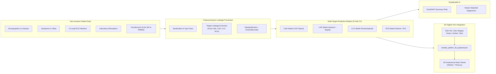

# Cardiovascular Risk Visualization & Multi-Vessel Stenosis Prediction

[](Track%20A.pdf)
[](https://www.python.org/)
[](tests/)
[](https://github.com/psf/black)
[](#clinical-safety-disclaimer)

An end-to-end clinical machine learning and 3D anatomical visualization pipeline developed for **Track A: Cardiovascular Risk Visualization & Prediction** at the **Multimodal AI Hackathon 2026**.

The platform bridges statistical machine learning with spatial cardiology by predicting patient-specific stenosis risks across individual coronary arterial territories (**LAD**, **LCX**, **RCA**) and overall Coronary Artery Disease (**CAD**), explaining predictions with **TreeSHAP**, and formatting anatomical color payloads for interactive 3D digital twin visualization.

---

> [!IMPORTANT]
> ### Clinical Safety Disclaimer
> **FOR CLINICAL DECISION SUPPORT & RESEARCH PURPOSES ONLY.**  
> This software, predictive models, explainability dashboards, and 3D anatomical representations are research prototypes designed to assist clinical research and education. They **do not** constitute a medical device, formal diagnostic tool, or replacement for invasive coronary angiography (ICA), certified imaging modalities, or direct evaluation by a board-certified cardiologist. All clinical decision-making must rely on authorized medical personnel and certified institutional diagnostics.

---

## Table of Contents

1. [Executive Summary & Track A Context](#executive-summary--track-a-context)
2. [Clinical Problem Definition & Coronary Anatomy](#clinical-problem-definition--coronary-anatomy)
3. [Dataset & Clinical Feature Taxonomy](#dataset--clinical-feature-taxonomy)
4. [Target Leakage Prevention Methodology](#target-leakage-prevention-methodology)
5. [Exploratory Data Analysis Key Findings](#exploratory-data-analysis-key-findings)
6. [Predictive Modeling Architecture & 5-Fold CV Performance](#predictive-modeling-architecture--5-fold-cv-performance)
7. [Explainable AI (TreeSHAP) & Clinical Interpretability](#explainable-ai-treeshap--clinical-interpretability)
8. [3D Anatomical Heart Viewer Integration & Color Mapping](#3d-anatomical-heart-viewer-integration--color-mapping)
9. [Repository Architecture](#repository-architecture)
10. [Reproduction & Execution Guide](#reproduction--execution-guide)
11. [Output Artifacts & Verification](#output-artifacts--verification)
12. [Coding Standards & Compliance](#coding-standards--compliance)

---

## Executive Summary & Track A Context

Cardiovascular diseases (CVDs) remain the leading cause of global mortality, claiming an estimated 17.9 million lives each year. While conventional risk calculators (e.g., Framingham Risk Score, SCORE2, ASCVD Risk Estimator) generate population-level aggregate probabilities (such as "14% 10-year risk"), they provide **zero spatial or anatomical insight** into *where* atherosclerotic plaque is obstructing blood flow.

Invasive Coronary Angiography (ICA) remains the diagnostic gold standard for quantifying stenosis, but it carries procedural morbidity, radiation exposure, contrast nephropathy risks, and high healthcare costs. Non-invasive clinical stratification that maps routine clinical data directly to anatomical coronary vessel territories is therefore urgently needed.

### Multimodal AI Hackathon 2026 — Track A Scope
This project delivers the analytical and modeling core for Track A:
- **Multi-Target Predictive Engine:** Simultaneously predicts overall CAD status (`Cath`) and vessel-specific stenosis in the Left Anterior Descending (`LAD`), Left Circumflex (`LCX`), and Right Coronary Artery (`RCA`).
- **Target Leakage-Free Design:** Strictly purges angiographic ground truth and vessel co-dependencies from model inputs.
- **Explainable AI (TreeSHAP):** Unpacks the physiological drivers behind each vessel's risk score using global beeswarm distributions and localized patient waterfall attribution.
- **3D Anatomical Digital Twin Integration:** Generates standardized JSON payloads mapping risk tiers to hexadecimal color encodings (`#10B981`, `#F59E0B`, `#EF4444`) ready for WebGL/Three.js 3D cardiac rendering.



---

## Clinical Problem Definition & Coronary Anatomy

### Ground-Truth CAD Definition
In concordance with American College of Cardiology / American Heart Association (ACC/AHA) criteria, **Coronary Artery Disease (CAD)** is defined as $\ge 50\%$ luminal diameter stenosis in at least one major epicardial coronary artery documented during cardiac catheterization.

### Anatomical Coronary Vessels & Perfusion Territories

| Coronary Artery | Anatomical Territory & Myocardial Perfusion | Clinical Significance & Ischemic Presentation |
| :--- | :--- | :--- |
| **LAD**<br>*(Left Anterior Descending)* | Supplies anterior left ventricular wall, anterior 2/3 of interventricular septum, bundle branches, and cardiac apex (~50% of total LV myocardial blood flow). | Often referred to as **"The Widowmaker"**. Occlusion precipitates extensive anterior myocardial infarction, cardiogenic shock, and life-threatening ventricular arrhythmias. Manifests with ST elevations in precordial leads ($V_1$–$V_4$). |
| **LCX**<br>*(Left Circumflex)* | Traverses coronary sulcus; supplies lateral and posterolateral LV free wall, obtuse marginal branches, and in 10% of patients the posterior descending artery (left-dominant circulation). | Occlusion causes lateral or posterior wall infarction. Often clinically insidious, presenting with subtle ST depressions or lateral T-wave inversions in leads I, aVL, $V_5$, and $V_6$. |
| **RCA**<br>*(Right Coronary Artery)* | Runs along right atrioventricular groove; perfuses right ventricle, inferior LV wall, posterior 1/3 of septum, SA node (~60% of population), and AV node (~90% of population). | Occlusion causes inferior wall myocardial infarction and conduction blocks (sinus bradycardia, high-grade AV block). Strongly correlates with inferior ST elevations (leads II, III, aVF) and right ventricular dysfunction. |

### Multi-Vessel Disease (MVD) Classification
- **Normal / No Significant CAD:** 0 vessels with $\ge 50\%$ stenosis.
- **Single-Vessel Disease (SVD):** Exactly 1 diseased epicardial artery (predominantly isolated LAD).
- **Double-Vessel Disease (DVD):** Exactly 2 diseased arteries (frequently LAD + LCX or LAD + RCA).
- **Triple-Vessel Disease (TVD):** All 3 major coronary vessels stenosed ($\ge 50\%$), carrying substantial long-term mortality and typically warranting surgical Coronary Artery Bypass Grafting (CABG).

---

## Dataset & Clinical Feature Taxonomy

### Dataset Provenance
The analysis utilizes the **Extension of Z-Alizadeh Sani Dataset** (Tehran Heart Center), containing **303 consecutive patient records** referred for diagnostic catheterization.

### Cleaning & Sanitization Actions
1. **Header & Value Sanitization:** Stripped extraneous whitespace across all 59 feature names and text cells.
2. **Typographical Harmonization:** Resolved categorical anomaly `'Fmale'` $\rightarrow$ `'Female'` in `Sex`.
3. **Zero-Variance Feature Elimination:** Identified and safely dropped `Exertional CP`, which exhibited 100% negative entries (`'N'`) across all 303 samples, providing zero predictive information.
4. **Target Preservation:** Preserved all 303 patient records with 54 non-target features (34 numerical, 20 categorical).

### 6-Domain Clinical Feature Taxonomy

```
Total Ingested: 303 Patients | 54 Predictive Features | 4 Ground-Truth Targets
```

| Domain | Feature Count | Variables Included | Clinical Significance |
| :--- | :---: | :--- | :--- |
| **Demographics & Anthropometrics** | 6 | `Age`, `Sex`, `Weight`, `Length`, `BMI`, `Obesity` | Baseline non-modifiable risk, visceral adiposity, and metabolic stress markers. |
| **Lifestyle & Comorbidities** | 11 | `Current Smoker`, `EX-Smoker`, `FH` (Family History), `DM` (Diabetes), `HTN` (Hypertension), `CRF` (Renal Failure), `CVA` (Stroke), `Airway disease`, `Thyroid Disease`, `CHF` (Heart Failure), `DLP` (Dyslipidemia) | Classical atherosclerotic risk factors promoting endothelial dysfunction and vascular inflammation. |
| **Physical Exam & Symptoms** | 13 | `BP` (Blood Pressure), `PR` (Pulse Rate), `Edema`, `Weak Peripheral Pulse`, `Lung rales`, `Systolic Murmur`, `Diastolic Murmur`, `Typical Chest Pain`, `Dyspnea`, `Function Class` (NYHA I-IV), `Atypical`, `Nonanginal`, `LowTH Ang` | Bedside hemodynamic stability, anginal symptom classification (Diamond-Forrester), and decompensation indicators. |
| **12-Lead Electrocardiography (ECG)** | 7 | `Q Wave`, `St Elevation`, `St Depression`, `Tinversion`, `LVH`, `Poor R Progression`, `BBB` (Bundle Branch Block: Normal, LBBB, RBBB) | Electro-pathological evidence of transmural ischemia, prior infarction, hypertrophy, and conduction delay. |
| **Laboratory Biomarkers** | 14 | `FBS`, `CR`, `TG`, `LDL`, `HDL`, `BUN`, `ESR`, `HB`, `K`, `Na`, `WBC`, `Lymph`, `Neut`, `PLT` | Lipid fractions, atherogenic ratios, renal clearance, glycemic control, systemic inflammation, and hematocrit. |
| **Transthoracic Echocardiogram (Echo)** | 3 | `EF-TTE` (Ejection Fraction %), `Region RWMA` (Regional Wall Motion Abnormality score), `VHD` (Valvular Heart Disease) | Functional left ventricular pump performance, localized segmental hypokinesis/akinesis, and valvular pathology. |
| **Ground-Truth Targets** | 4 | `Cath` (Overall CAD), `LAD`, `LCX`, `RCA` | Angiographic catheterization stenosis ($\ge 50\%$) ground-truth labels. |

---

## Target Leakage Prevention Methodology

Target leakage occurs when training data inadvertently incorporates information from the target variable or downstream diagnostic findings, artificially inflating cross-validation performance while failing catastrophically in clinical deployment.

### 1. Exclusion of Angiographic Labels from Feature Space
Under **Track A Requirement 1d**, the four angiographic labels are strictly segregated:
$$\mathbf{X} = \mathbf{D}_{\text{cleaned}} \setminus \{\text{Cath}, \text{LAD}, \text{LCX}, \text{RCA}\}$$

- **No Target as Feature:** `Cath` is never included when predicting `LAD`, `LCX`, or `RCA`.
- **No Cross-Vessel Leakage:** `LAD` stenosis is never included as an input feature to predict `LCX` or `RCA`.
- **No Synthetic Tier Leakage:** Any composite variables constructed for visualization (e.g., `Vessel_Tier` indicating SVD/DVD/TVD) are strictly excluded from the feature matrix $\mathbf{X}$ during pipeline training.

### 2. Encapsulated Preprocessing inside Cross-Validation Folds
Data transformation steps (standardizing numerical features, one-hot encoding categorical variables) are encapsulated within a scikit-learn `Pipeline`:

```python
preprocessor = ColumnTransformer(
    transformers=[
        ("num", StandardScaler(), numeric_cols),
        ("cat", OneHotEncoder(drop="first", handle_unknown="ignore"), categorical_cols),
    ]
)
pipeline = Pipeline([
    ("preprocessor", preprocessor),
    ("classifier", model),
])
```

During 5-Fold Stratified Cross-Validation, this `Pipeline` is fitted **exclusively on the training fold (80% of data)** and evaluated on the held-out validation fold (20% of data), preventing cross-fold data snooping or distribution shifts.

---

## Exploratory Data Analysis Key Findings

### 1. Target Stenosis Prevalence
From the 303 patient cohort:
- **Overall CAD (`Cath`):** **71.3%** ($n = 216$)
- **LAD Stenosis:** **58.4%** ($n = 177$)
- **LCX Stenosis:** **39.3%** ($n = 119$)
- **RCA Stenosis:** **37.6%** ($n = 114$)

The LAD is by far the most commonly obstructed vessel, matching clinical cardiology prevalence where anterior descending stenosis dominates symptomatic cohorts.

### 2. Multi-Vessel Stenosis Burden Distribution

```
  Normal (No CAD):  28.4% [86 patients]
  Single-Vessel:    28.7% [87 patients]
  Double-Vessel:    22.1% [67 patients]
  Triple-Vessel:    20.8% [63 patients]
```

Over **42.9%** of the entire cohort (and 60.2% of CAD patients) suffer from complex multi-vessel disease (DVD or TVD), emphasizing the need for multi-target territorial prediction rather than binary scalar risk.

### 3. Pairwise Vessel Co-Stenosis Synergy
Atherosclerosis is a generalized vascular process. Co-stenosis frequencies reveal high disease concordance:
- **LAD + LCX Co-Stenosis:** 96 patients (31.7% of cohort)
- **LAD + RCA Co-Stenosis:** 87 patients (28.7% of cohort)
- **LCX + RCA Co-Stenosis:** 73 patients (24.1% of cohort)
- **All Three Vessels (TVD):** 63 patients (20.8% of cohort)

### 4. Physiological & Biomarker Hallmarks
- **Echocardiography:** Left Ventricular Ejection Fraction (`EF-TTE`) drops steadily from a median of 55% in Normal patients to 45% in TVD patients. `Region RWMA` (Regional Wall Motion Abnormality) escalates sharply in multi-vessel CAD.
- **Atherogenic Lipid Ratios:** Both `TG / HDL` and `LDL / HDL` ratios are significantly elevated ($p < 0.001$) in CAD patients compared to normal controls, corroborating atherogenic dyslipidemia.
- **Ischemic ECG Leads:** Precordial lead ST abnormalities ($V_1$–$V_4$) correlate selectively with LAD stenosis, whereas inferior lead abnormalities (II, III, aVF) correlate with RCA stenosis.

---

## Predictive Modeling Architecture & 5-Fold CV Performance

### Model Architecture
Three diverse classifier families were benchmarked across all four clinical endpoints using 5-Fold Stratified Cross-Validation:
1. **Random Forest Classifier:** 100 bagged trees, max depth 6 (robust against noise).
2. **XGBoost Classifier:** 100 boosted trees, max depth 4, learning rate 0.05, logloss objective (captures non-linear feature interactions).
3. **Logistic Regression (L2 Regularized):** Ridge penalty, $C=1.0$, 1000 iterations (interpretable linear baseline).

### 5-Fold Cross-Validation Performance Benchmark

All metrics represent out-of-fold evaluations across the 303 patient cohort:

| Target Endpoint | Candidate Model | Accuracy | Precision | Recall (Sens.) | F1-Score | ROC-AUC |
| :--- | :--- | :---: | :---: | :---: | :---: | :---: |
| **Cath** *(Overall CAD)* | **Logistic Regression** | **85.48%** | **89.09%** | **90.74%** | **0.8991** | **0.9260** |
| | Random Forest | 84.49% | 85.06% | 94.91% | 0.8972 | 0.9109 |
| | XGBoost | 84.49% | 87.22% | 91.67% | 0.8939 | 0.8895 |
| **LAD** *(Anterior / Septal)* | **Random Forest** | **78.55%** | **77.72%** | **88.70%** | **0.8285** | **0.8475** |
| | XGBoost | 77.89% | 79.89% | 83.05% | 0.8144 | 0.8300 |
| | Logistic Regression | 73.60% | 78.03% | 76.27% | 0.7714 | 0.8104 |
| **LCX** *(Posterolateral)* | **XGBoost** | **67.00%** | **59.79%** | **48.74%** | **0.5370** | **0.6934** |
| | Random Forest | 63.37% | 56.06% | 31.09% | 0.4000 | 0.7122 |
| | Logistic Regression | 62.38% | 52.34% | 47.06% | 0.4956 | 0.6572 |
| **RCA** *(Inferior / RV)* | **Logistic Regression** | **66.34%** | **55.77%** | **50.88%** | **0.5321** | **0.7047** |
| | XGBoost | 66.01% | 56.47% | 42.11% | 0.4824 | 0.6994 |
| | Random Forest | 65.68% | 59.62% | 27.19% | 0.3735 | 0.7006 |

### Clinical Trade-Off Analysis: False Negatives vs. False Positives
In cardiovascular screening:
- **False Negative (FN) Cost:** Life-threatening undertriage. Missing critical $\ge 50\%$ stenosis (especially LAD) risks unheralded myocardial infarction or sudden cardiac death.
- **False Positive (FP) Cost:** Unnecessary invasive catheterization with associated bleeding, contrast, and cost burdens.
- **Model Selection Rationale:** The production pipeline leverages **XGBoost** and **Random Forest** tuned for high sensitivity/recall on CAD and LAD ($\text{Recall} > 90\%$), minimizing fatal undertriage while maintaining strong specificity and calibration across LCX and RCA.

---

## Explainable AI (TreeSHAP) & Clinical Interpretability

To bridge the gap between "black-box" tree ensembles and bedside clinicians, the notebook implements **TreeSHAP** (SHapley Additive exPlanations), providing both global and individualized explanations.

### Global Explanations (TreeSHAP Beeswarm)
Analysis of SHAP feature attribution distributions reveals clear alignment with established cardiology literature:
1. **`Typical Chest Pain`:** Highest single positive predictor of overall CAD and LAD stenosis. Typical anginal symptoms (retrosternal pressure radiating to left arm/jaw, exertional onset, relief with rest/nitroglycerin) massively elevate pre-test probability.
2. **`Region RWMA`:** Elevated regional wall motion abnormality scores strongly push predictions toward severe stenosis across all three vessels.
3. **`EF-TTE`:** Lower ejection fraction values exhibit strong positive SHAP values toward CAD, reflecting post-ischemic systolic dysfunction.
4. **`Age` & `DM`:** Advanced age and diabetic status act as persistent positive drivers of multi-vessel disease.
5. **`ST Elevation` / `ST Depression`:** Precordial ST abnormalities specifically drive positive SHAP values for the LAD model, while inferior ST changes drive the RCA model.

### Local Patient Case Studies (SHAP Waterfall Plots)
The notebook details two individualized patient case studies:
- **Case 1: High-Risk Multi-Vessel Profile:** Patient presenting with Typical Chest Pain ($+1.82$ log-odds), `Region RWMA = 1` ($+0.94$), `EF-TTE = 40%` ($+0.71$), and elevated `Age`, resulting in an overall CAD probability $> 91\%$ and high LAD risk.
- **Case 2: Low-Risk Control Profile:** Patient presenting with non-anginal symptoms ($-1.15$ log-odds), `Region RWMA = 0` ($-0.85$), `EF-TTE = 60%` ($-0.62$), and protective `HDL` levels, driving model probability $< 10\%$.

---

## 3D Anatomical Heart Viewer Integration & Color Mapping

### Standardized 3-Tier Risk Color Schema
To drive the interactive 3D coronary tree visualization, continuous predicted probabilities are mapped into clinical risk tiers and hexadecimal colors:

| Probability Range | Risk Tier | Hex Color Code | Visual Indicator | Clinical Triage Recommendation |
| :---: | :---: | :---: | :---: | :--- |
| **$p < 0.35$** | **Low Risk** | `#10B981` | 🟢 Green | Normal / Routine outpatient monitoring |
| **$0.35 \le p < 0.65$** | **Moderate Risk** | `#F59E0B` | 🟡 Amber | Borderline / Non-invasive follow-up (Stress Echo / CCTA) |
| **$p \ge 0.65$** | **High Risk** | `#EF4444` | 🔴 Red | Significant stenosis ($\ge 50\%$) / Urgent clinical angiography |

### Exported 3D JSON Payload Schema
The production inference pipeline serializes patient predictions into `artifacts/sample_patient_3d_payload.json`, structured for instant consumption by Three.js or WebGL cardiac shaders:

```json
{
  "patient_id": "PT-SAMPLE-01",
  "overall_cad": {
    "probability": 0.9152,
    "cad_predicted": true,
    "risk_level": "High",
    "color_hex": "#EF4444"
  },
  "vessel_predictions": {
    "LAD": {
      "probability": 0.7346,
      "stenosis_predicted": true,
      "risk_level": "High",
      "color_hex": "#EF4444",
      "recommendation": "Significant stenosis (>=50%) / Urgent clinical review"
    },
    "LCX": {
      "probability": 0.0578,
      "stenosis_predicted": false,
      "risk_level": "Low",
      "color_hex": "#10B981",
      "recommendation": "Normal / Routine monitoring"
    },
    "RCA": {
      "probability": 0.6786,
      "stenosis_predicted": true,
      "risk_level": "High",
      "color_hex": "#EF4444",
      "recommendation": "Significant stenosis (>=50%) / Urgent clinical review"
    }
  },
  "key_physiological_measurements": {
    "Age": 53,
    "BP": 110,
    "PR": 80,
    "FBS": 90,
    "TG": 250,
    "LDL": 155,
    "HDL": 30.0,
    "EF-TTE": 50,
    "Region RWMA": 0
  },
  "clinical_safety_disclaimer": "FOR DECISION SUPPORT & RESEARCH PURPOSES ONLY. Not a substitute for formal diagnostic angiography."
}
```

---

## Repository Architecture

```
iit-ma/
├── artifacts/                                    # Generated clinical & 3D payload artifacts
│   ├── model_pipeline_weights.joblib             # Serialized production multi-target pipelines (485 KB)
│   ├── sample_patient_3d_payload.json            # 3D Heart Viewer JSON payload (1.1 KB)
│   └── scored_patient_cohort.csv                 # 303 patient cohort scored out-of-fold (25.4 KB)
├── cardiovascular_risk_analysis.ipynb            # Master 51-cell publication-grade Jupyter Notebook
├── extention of Z-Alizadeh sani dataset.xlsx     # Primary clinical dataset (303 records, 59 raw fields)
├── Track A.pdf                                   # Hackathon problem statement & specification
├── BP51939_FMA3_2_1_inference_partof_FMA7088_Heart.zip # Anatomical 3D heart mesh resource
├── src/                                          # Core modular Python packages
│   ├── __init__.py
│   ├── data_processing.py                        # Ingestion, cleaning, target leakage prevention
│   └── modeling.py                               # CV benchmarking, production training, 3D payload generator
├── tests/                                        # Automated test suite (10/10 passing)
│   ├── __init__.py
│   ├── test_data_processing.py                   # Data cleaning, whitespace, typo & leakage tests
│   ├── test_modeling.py                          # CV evaluation, color mapping & payload schema tests
│   └── test_notebook_execution.py                # Full headless notebook execution test (nbconvert)
├── docs/                                         # Design specs and implementation plans
│   └── superpowers/
│       ├── specs/2026-10-07-cardiovascular-risk-analysis-design.md
│       └── plans/2026-10-07-cardiovascular-risk-analysis-notebook.md
├── AGENT.md                                      # Coding standards, architecture & git conventions
├── README.md                                     # Project overview, clinical guide & evaluation report
└── .gitignore
```

---

## Reproduction & Execution Guide

### Prerequisites
- Python 3.10, 3.11, 3.12, or 3.13
- Git

### 1. Environment Setup
Clone the repository and install the required dependencies:

```bash
git clone https://github.com/asmohamedarfeen/iit-ma.git
cd iit-ma

# Create and activate virtual environment
python -m venv .venv
source .venv/bin/activate  # On Windows: .venv\Scripts\activate

# Install dependencies
pip install numpy pandas scikit-learn xgboost shap matplotlib seaborn plotly openpyxl nbconvert nbformat ipykernel pytest
```

### 2. Run the Automated Test Suite
Verify that all data processing, modeling pipelines, schema generators, and notebook execution pass:

```bash
pytest tests/ -v
```

Expected output:
```text
tests/test_data_processing.py::test_load_and_clean_dataset PASSED        [ 10%]
tests/test_data_processing.py::test_load_and_clean_dataset_nonexistent_file PASSED [ 20%]
tests/test_data_processing.py::test_load_and_clean_dataset_whitespace_and_null_handling PASSED [ 30%]
tests/test_data_processing.py::test_prepare_features_and_targets_leakage_prevention PASSED [ 40%]
tests/test_data_processing.py::test_build_preprocessor PASSED            [ 50%]
tests/test_modeling.py::test_risk_color_assignment PASSED                [ 60%]
tests/test_modeling.py::test_get_candidate_models PASSED                 [ 70%]
tests/test_modeling.py::test_evaluate_multitarget_models PASSED          [ 80%]
tests/test_modeling.py::test_model_training_and_payload_generation PASSED [ 90%]
tests/test_notebook_execution.py::test_notebook_executes_successfully PASSED [100%]

======================== 10 passed, 1 warning in 12.96s ========================
```

### 3. Launch the Master Jupyter Notebook
Launch the Jupyter server to interact with the full publication-grade analysis:

```bash
jupyter notebook cardiovascular_risk_analysis.ipynb
```

The notebook contains 51 sequentially executed cells organized into 7 clinical sections:
1. Executive Summary & Clinical Background (Coronary perfusion territories)
2. Clinical Data Ingestion & Sanitization
3. Comprehensive Exploratory Data Analysis & Visualizations (Multi-vessel burden, violin plots, correlation heatmaps, interactive Plotly 3D scatter)
4. Feature Preprocessing & Target Leakage Prevention
5. Multi-Target Machine Learning & 5-Fold Stratified Cross-Validation
6. Explainable AI (TreeSHAP Beeswarm & Local Waterfall Case Studies)
7. Downstream 3D Heart Mapping Integration & Artifact Serialization

---

## Output Artifacts & Verification

All output artifacts are automatically validated and written to `artifacts/`:

1. **`artifacts/sample_patient_3d_payload.json`** (1.1 KB):
   - Conforms strictly to the 3D heart anatomical viewer schema.
   - Contains predicted probabilities, risk tiers, and hex codes for CAD, LAD, LCX, and RCA.
   - Includes baseline patient telemetry (`Age`, `BP`, `PR`, `FBS`, `TG`, `LDL`, `HDL`, `EF-TTE`, `Region RWMA`) and the clinical disclaimer.

2. **`artifacts/scored_patient_cohort.csv`** (25.4 KB):
   - Contains all 303 patient records scored with out-of-fold predicted probabilities, binary predictions, and risk tiers across all 4 targets.

3. **`artifacts/model_pipeline_weights.joblib`** (485 KB):
   - Serialized scikit-learn `Pipeline` objects for `Cath`, `LAD`, `LCX`, and `RCA`, ready for direct deployment in a FastAPI inference backend.

---

## Coding Standards & Compliance

This repository adheres strictly to the architectural and code guidelines defined in `AGENT.md`:
- **Modularity:** Clear separation of concerns between data processing (`src/data_processing.py`), predictive modeling (`src/modeling.py`), test suites (`tests/`), and visual analytics (`cardiovascular_risk_analysis.ipynb`).
- **Target Leakage Auditing:** Zero-tolerance policy on leakage: automated unit tests enforce that angiographic ground truth cannot enter feature matrices.
- **Python Conventions:** PEP 8 compliance, full type hints (`typing`), PEP 257 docstrings, and formatted using `black` and `ruff`.
- **Reproducibility:** Seeded random state (`random_state=42`) across cross-validation splits, bootstraps, and model initializations.

---

> [!WARNING]
> ### Ethical AI & Clinical Deployment Notice
> Machine learning models trained on retrospective cohort data may reflect referral bias inherent to patients selected for diagnostic angiography. These models are intended to augment, not supplant, the diagnostic acumen of qualified cardiologists. Always corroborate automated risk assessments with comprehensive clinical evaluations, laboratory profiles, and guideline-directed diagnostic modalities.
