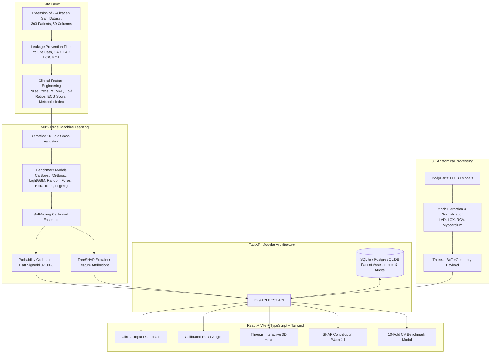

# CardioVision AI - System Architecture & Technical Specification

## 1. System Overview

CardioVision AI is a multi-task, clinically interpretable machine learning system designed to predict overall Coronary Artery Disease (CAD) and vessel-specific stenosis in the three primary coronary arteries (LAD, LCX, RCA). It pairs calibrated predictive machine learning with real-time 3D anatomical visualization and TreeSHAP explainability.

---

## 2. Architecture Diagram

---

## 3. Machine Learning Performance (Stratified 10-Fold CV)

All metrics were computed across 10 stratified folds on the full 303-patient cohort without data leakage:

| Target Territory | Best Model | ROC-AUC | F1 Score | Accuracy | Primary Clinical Biomarkers |
| :--- | :--- | :---: | :---: | :---: | :--- |
| **Overall CAD (Cath)** | **Soft-Voting Ensemble** | **93.2%** | **91.1%** | **87.1%** | Typical Chest Pain, Echo EF, Age, Region RWMA |
| **LAD Stenosis** | **Extra Trees / CatBoost** | **85.3%** | **84.6%** | **81.2%** | Typical Angina, ST Elevation, Regional RWMA |
| **LCX Stenosis** | **Soft-Voting Ensemble** | **74.2%** | **59.0%** | **70.3%** | Function Class, Age, LDL/HDL Ratio, Dyspnea |
| **RCA Stenosis** | **Extra Trees / Ensemble** | **71.7%** | **53.4%** | **66.3%** | BP, ST Depression, T-Inversion, Dyslipidemia |

---

## 4. 3D Anatomical Vessel Color Standards

Risk probabilities are converted to standardized color states in the 3D Three.js anatomical canvas:

- **Green (`#10B981`)**: Probability $< 35\%$ — Normal / Low Stenosis Likelihood
- **Amber (`#F59E0B`)**: $35\% \le$ Probability $< 65\%$ — Borderline / Intermediate Risk
- **Red (`#EF4444`)**: Probability $\ge 65\%$ — Significant Stenosis Likelihood
