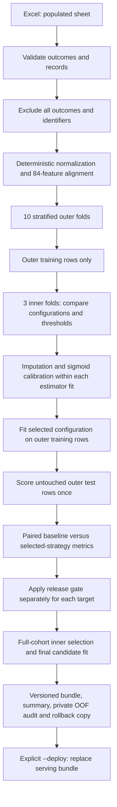
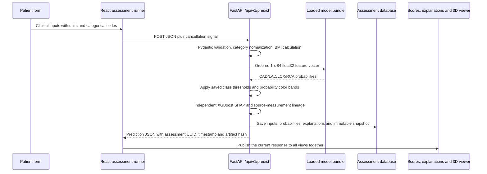

# CardioVision: training, inference and data transfer

This implementation addresses Track A's four classification targets and connects
their probabilities to the existing React/Three.js dashboard. The trained model
is a local artifact; patient requests never train or tune a model.

## Verified deployed result

Release `20261010T044519Z-77a76019` is loaded by the local application. Its bundle
SHA-256 is `0138162c96a87500b8d8abf0132f831b938b89b5f62e4277f022d0482a3de544`.
RCA now uses sigmoid-calibrated LightGBM-d3 with a final classification threshold
of 0.40. The other three fitted predictors and their 0.50 thresholds are retained.

| Target | Previous accuracy | Released strategy accuracy | Previous recall | Released strategy recall |
|---|---:|---:|---:|---:|
| CAD | 88.78% | 88.78% | 93.98% | 93.98% |
| LAD | 80.53% | 80.53% | 87.57% | 87.57% |
| LCX | 71.29% | 71.29% | 55.46% | 55.46% |
| RCA | 67.66% | 68.32% | 45.61% | 55.26% |

The RCA strategy correctly classifies 207 rather than 205 of the 303 outer-held-out
records; it detects 63 rather than 52 of 114 positive cases. These modest internal
results include the selection limitations below. They are not independent validation
of the final full-cohort fitted model. See the [release summary](../artifacts/model_releases/20261010T044519Z-77a76019/summary.json)
and [six-page project report](../output/pdf/cardiovision-track-a.pdf).

Verification: 122 backend tests, 64 frontend tests, production frontend build,
release hash/OOF audit, and a live synthetic prediction plus saved PDF download.
The historical release metadata contains a generic three-fold candidate label;
its archived configuration parameters correctly record the established candidate
and baseline at five folds, and the regularized candidate at three. Current training
code uses a configuration-specific label; the historical audit is preserved unchanged.

## 1. Dataset and input contract

The supplied workbook's `Sheet 1 - Table 1` contains 303 records and 59 columns.
The second sheet contains headers without records and is not used. There are no
missing values or duplicate complete rows in the populated sheet.

| Target | Positive label | Positive / negative records |
|---|---|---|
| CAD | `Cath = CAD` | 216 / 87 |
| LAD | `LAD = Stenotic` | 177 / 126 |
| LCX | `LCX = Stenotic` | 119 / 184 |
| RCA | `RCA = Stenotic` | 114 / 189 |

`Cath`, `CAD`, `LAD`, `LCX` and `RCA` are excluded from **every** predictor.
The constant `Exertional CP` column is also excluded. Patient identifiers are not
features. Category encodings live in `backend/cardio/constants.py`; missing or
unknown outcome labels are rejected, never silently converted to negative.

Training and serving share `feature_service.py`. The saved bundle's ordered 84
float32 features are preserved and checked against its saved reference vectors.
Two additional engineered lipid-ratio aliases are excluded by this saved order.
Raw-feature ablations select recorded columns inside a sklearn pipeline.

The improvement command rejects incomplete source records before the legacy
normalization wrapper could calculate global medians. Candidate imputation is
inside each calibration estimator fit. For a future incomplete cohort, use the
existing raw-record `ClinicalPreprocessor` pipeline and verify its training-only
imputation; do not bypass the complete-record check.

Derived features are fixed formulas, not measured observations. Estimated
diastolic pressure, calculated lipid indices, composite pretest scores and RWMA
territory flags are legacy assumptions. They are not validated clinical scores
or lesion coordinates. Existing formula quirks are retained for saved-weight
compatibility, and raw-feature ablations test removing these derived inputs.

## 2. Offline training and release flow



Search compares the existing calibrated ensemble with regularized CatBoost,
LightGBM, XGBoost, Random Forest and Extra Trees configurations. CatBoost and
LightGBM also have raw-feature ablations. New candidates use three-fold sigmoid
calibration; the baseline retains its saved five-fold calibration configuration.
RCA uses a smaller shortlist: the current predictor, the established LightGBM
configuration with five-fold calibration, and a regularized LightGBM configuration
with three-fold calibration. A first broader trial produced no promoted models;
the subsequent RCA-focused trial is explicitly marked as additional cohort reuse.
The entire candidate-calibration fit is nested inside each selection fold.

Threshold candidates are 0.35, 0.40, 0.45, 0.50, 0.55, 0.60 and 0.65. Inner selection
maximizes accuracy while limiting recall and ROC-AUC loss to 0.02 and Brier score
increase to 0.01 relative to the inner baseline at 0.50. Ties prefer lower Brier
score, then a threshold closer to 0.50. The unchanged baseline is always eligible.

`--targets RCA` tunes only RCA. Other targets receive baseline-only outer
evaluation, and retain their loaded thresholds, names and fitted weights. Subsequent
releases compare against each target's loaded class threshold, rather than
assuming every current predictor still uses 0.50.

Outer evaluation compares that complete selection procedure with the baseline
on identical patients. Release requires strictly higher accuracy, recall and
ROC-AUC losses no larger than 0.02, and Brier increase no larger than 0.01. A failed
target retains its original fitted model and existing class threshold. These are
engineering tolerances, not clinical decision criteria or significance tests.

For a promoted target, the final model and class threshold are chosen using
full-cohort **inner** predictions, not by optimizing the outer test predictions.
Consequently, outer metrics estimate the selection procedure, not the exact
full-cohort weights. Choosing promotion after inspecting outer metrics adds
release-selection optimism; the report explicitly records this limitation.

Each release stores hashes of the dataset, original bundle, final bundle and
archived source; exact dependency versions; final configurations; fold selections;
private row-level predictions; and original artifacts for rollback. Row-level OOF
files are owner-readable and excluded from Git. The summary has no raw patient
measurements. Source/input drift prevents publication.

## 3. Patient request and response flow



| Boundary | Data transferred | Contract / implementation |
|---|---|---|
| Form to frontend runner | Clinical `PatientData` object | `PatientForm` and `utils/assessment.ts` |
| Browser to API | JSON with aliases such as `EF-TTE` and `Typical Chest Pain` | `services/api.ts`, POST `/api/v1/predict` |
| API validation | Typed measurements, range/category checks, computed BMI | `PatientInputSchema`; invalid input returns 422 |
| Feature service to model | One row, 84 ordered numeric features | `prepare_features(..., feature_names=bundle['feature_names'])` |
| Model to response | Four probabilities, classes, class thresholds and mesh colors | `PredictionService`, `PredictionResponse` |
| Response to database | Validated inputs and immutable prediction snapshot | `CardioRepository.create_assessment` |
| API to browser | JSON, one assessment UUID, UTC time and exact model hash | `apiService.predictPatient` |
| Browser to visualization | CAD card, three artery cards, source-linked SHAP and mesh colors | `DashboardPage` state update |

The API accepts partial inputs and supplies schema defaults for omitted
measurements. Those defaults are assumptions, not observed patient values. Review
all clinical inputs before interpreting a result. BMI is computed per patient
from kilograms and centimeters if omitted. Unsupported categories are rejected.

Predicted status uses the unrounded probability and saved per-target threshold:
`CAD` or `Normal` for CAD; `Stenotic` or `Normal` for arteries. The API rounds display
probability to four decimals and percentage to one decimal afterward. Class
decisions are research predictions and do not indicate measured blockage.

After a first assessment, valid edits trigger reassessment after 700 ms. The runner
cancels superseded requests and rejects late responses using a generation token.
Previous evidence is hidden while inputs are stale. One current response updates
the scores, explanation panel and 3D colors together.

If inference fails, the endpoint returns a generic failure. If persistence fails,
the database transaction is rolled back; a successfully saved immutable snapshot
is required for report availability. Downloading an evidence report uses the
snapshot and does not rerun prediction or consume edited form data.

Existing database `*_classification` columns retain the probability display-band
labels for compatibility. The immutable JSON snapshot also contains the binary
`predicted_status` and `decision_threshold`; consumers needing disease-class
decisions should read those explicit fields.

## 4. Anatomy and explanations

The anatomy asset is separate from patient inference. `process_3d_heart.py`
converts the supplied mesh resource into normalized geometry. The browser first
loads `frontend/public/heart_model_anatomy.json`, with `/api/v1/3d-anatomy` as its
fallback. Rotation, zoom and artery selection use the existing Three.js viewer.

| Model output | Response color key | Reference mesh |
|---|---|---|
| LAD probability | `vessel_colors_3d.lad` | LAD |
| LCX probability | `vessel_colors_3d.lcx` | LCX |
| RCA probability | `vessel_colors_3d.rca` | RCA |

Colors remain green below 35%, amber from 35% to below 65%, and red at 65% or
above. Class-threshold tuning does not rescale probability or recolor a score.
Myocardium remains neutral. No clinical feature is mapped to a patient-specific
lesion position or percentage narrowing.

TreeSHAP uses independently fitted XGBoost models already stored in the bundle.
Signed contributions are log-odds for those models, not changes in the deployed
calibrated probability. Original measurements and derivations accompany each
factor. The application and report disclose this surrogate explanation boundary.
Visible educational/decision-support disclaimers remain in place.

## 5. Run, verify and roll back

From the project root:

```bash
# Evaluate and stage; leaves the serving bundle unchanged.
MPLCONFIGDIR=/tmp/cardiovision-mpl .venv/bin/python scripts/improve_models.py

# Evaluate, stage, and deploy only targets that pass the release gate.
MPLCONFIGDIR=/tmp/cardiovision-mpl .venv/bin/python scripts/improve_models.py --deploy

# RCA-focused release; the other three fitted predictors are preserved.
MPLCONFIGDIR=/tmp/cardiovision-mpl .venv/bin/python scripts/improve_models.py --targets RCA --deploy

# Audit a completed release without fitting models.
.venv/bin/python scripts/improve_models.py --verify artifacts/model_releases/RELEASE_ID

# Regression tests and production frontend build.
.venv/bin/python -m pytest testing/backend -q
npm --prefix frontend test
npm --prefix frontend run build

# Start both services. Restart an already-running backend to load new weights.
./deploy/scripts/start.sh
```

`RELEASE_ID` denotes the concrete release directory printed by the training
command. Its `baseline/` contains the prior bundle and benchmark. To roll back,
copy those two files back into `artifacts/` and restart the backend. Preserve the
release directory so previous assessment hashes remain traceable.

The existing Model Quality Lab's archived run remains available. Its hash-based
staleness check correctly flags it when serving weights change; its old candidate
charts must not be represented as measurements of the new release. The Model
Evidence dialog reads the updated paired comparison from `/benchmarks`, and new
assessment snapshots carry the loaded bundle's release-specific validation.

## 6. Validation limits and references

These are internal results on one 303-person cohort. Historical configuration
development on this dataset and subsequent release selection can produce
optimism. Correlated features, small artery-positive counts and fold variability
limit what an accuracy gain proves. There is no independent external validation,
validated clinical operating point or patient-specific imaging. A demonstration
using training examples is a functionality check, not a performance evaluation.

- Problem requirements: local `Track A.pdf`, pages 1-4.
- Dataset reference: [UCI extension of Z-Alizadeh Sani](https://archive.ics.uci.edu/dataset/411/extention+of+z+alizadeh+sani+dataset).
- Evaluation: [scikit-learn nested cross-validation](https://scikit-learn.org/1.7/auto_examples/model_selection/plot_nested_cross_validation_iris.html).
- Probability estimation: [scikit-learn calibration](https://scikit-learn.org/1.7/modules/calibration.html).
