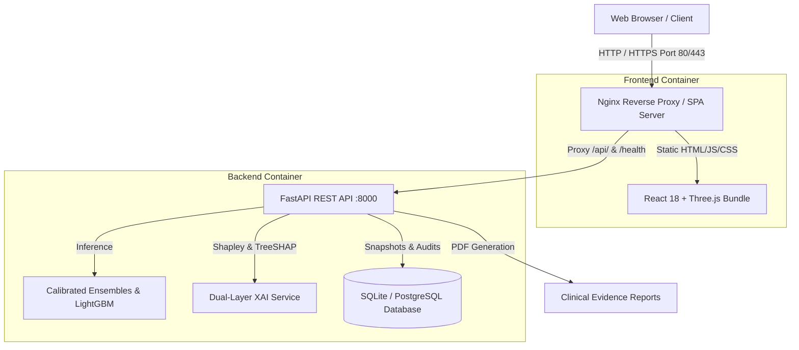

# 🚀 CardioVision AI — Production Hosting & Deployment Guide

This guide provides end-to-end instructions for deploying and hosting **CardioVision AI** across local environments, virtual private servers (VPS), and modern cloud platforms (Render, Railway, Fly.io, Google Cloud Run).

---

## 📋 Table of Contents
1. [Architecture Overview](#1-architecture-overview)
2. [Hosting Strategies Summary](#2-hosting-strategies-summary)
3. [Method 1: Local & Server Hosting with Docker Compose (Recommended)](#3-method-1-docker-compose-deployment)
4. [Method 2: One-Click Cloud PaaS Deployment (Render / Railway / Fly.io)](#4-method-2-cloud-paas-deployment)
5. [Method 3: Dedicated Production Server (AWS EC2 / DigitalOcean / Hetzner)](#5-method-3-dedicated-vps--cloud-vm)
6. [Method 4: SSL/TLS Setup with Let's Encrypt & Nginx](#6-method-4-ssltls-setup-with-lets-encrypt)
7. [Environment Variables Reference](#7-environment-variables-reference)
8. [Database Persistence & Backup Operations](#8-database-persistence--backup-operations)
9. [Operational Commands & Troubleshooting](#9-operational-commands--troubleshooting)

---

## 1. Architecture Overview

In a hosted container environment, CardioVision AI operates as follows:



---

## 2. Hosting Strategies Summary

| Deployment Type | Target Platforms | Config File | Best For |
| :--- | :--- | :--- | :--- |
| **Full-Stack Docker Compose** | Localhost, Ubuntu VPS, AWS EC2, DigitalOcean | `docker-compose.yml` | Full control, Nginx reverse proxy, production performance |
| **All-in-One Single Container** | Render.com, Railway, Fly.io, Google Cloud Run | `Dockerfile` | Cloud PaaS, free/cheap tiers, zero-configuration setup |
| **Dedicated Production Stack** | Dedicated server with custom domain & SSL | `docker-compose.prod.yml` | Enterprise / clinic deployments with strict uptime |

---

## 3. Method 1: Docker Compose Deployment

The quickest way to host the complete full-stack system on any Docker-capable machine:

### Step 1: Clone Repository & Configure Environment
```bash
git clone https://github.com/asmohamedarfeen/IIT-Mandi-Hackathon-.git
cd IIT-Mandi-Hackathon-

# Copy the environment template
cp .env.example .env
```

### Step 2: Launch the Stack
```bash
# Launch containers in the background with auto-restart
docker compose up -d --build
```

### Step 3: Verify the Running Services
```bash
# Check container status
docker compose ps

# Test the backend health endpoint
curl http://localhost:8000/health
```

- 🌐 **Web Application**: [http://localhost](http://localhost) (port 80)
- 📚 **Swagger API Docs**: [http://localhost:8000/docs](http://localhost:8000/docs)
- 🩺 **Health Endpoint**: [http://localhost:8000/health](http://localhost:8000/health)

*(To customize ports, edit `BACKEND_PORT` and `FRONTEND_PORT` in `.env`)*

---

## 4. Method 2: Cloud PaaS Deployment

If you do not have a dedicated server, you can deploy CardioVision AI in minutes using the unified **`Dockerfile`**.

### Option A: Render.com (Recommended for Hackathons)
1. Fork or push this repository to GitHub.
2. Sign in to [Render.com](https://render.com) and click **New > Blueprint**.
3. Select your repository. Render will automatically detect the [`render.yaml`](../render.yaml) blueprint!
4. Click **Apply**. Render will:
   - Build the React SPA and Python backend into a single container.
   - Run Alembic migrations on startup.
   - Provision a persistent disk for SQLite assessments.
   - Issue a free **HTTPS** domain (`https://your-app.onrender.com`).

### Option B: Railway.app
1. Go to [Railway.app](https://railway.app) and click **New Project > Deploy from GitHub repo**.
2. Select this repository.
3. Railway detects the root `Dockerfile` and builds the image automatically.
4. Under **Variables**, add:
   - `SERVE_FRONTEND=true`
   - `DATABASE_URL=sqlite:////app/data/cardiovision.db`
5. Under **Settings > Networking**, click **Generate Domain**.

### Option C: Fly.io
1. Install Fly CLI: `curl -L https://fly.io/install.sh | sh`
2. Run in the repository root:
   ```bash
   fly launch
   fly deploy
   ```
   *(Fly.io uses [`fly.toml`](../fly.toml) with an allocated 1GB persistent volume).*

---

## 5. Method 3: Dedicated VPS / Cloud VM

For hosting on an Ubuntu/Debian server (AWS EC2, DigitalOcean Droplet, Hetzner Cloud):

### 1-Command Automated Server Deployment
We provide an automated deployment script in `deploy/scripts/deploy.sh`:

```bash
# Make script executable and run
chmod +x deploy/scripts/deploy.sh
./deploy/scripts/deploy.sh --prod
```

This script:
1. Validates that Docker & Docker Compose are installed.
2. Creates `.env` from template if missing.
3. Builds the production image stack.
4. Waits for container readiness and tests the `/health` endpoint.

---

## 6. Method 4: SSL/TLS Setup with Let's Encrypt

When exposing CardioVision AI to the public internet on a custom domain (e.g., `cardiovision.yourdomain.com`):

### Step 1: Install Certbot on Host
```bash
sudo apt-get update
sudo apt-get install -y certbot
```

### Step 2: Obtain SSL Certificate
```bash
# Temporarily stop container on port 80 if running
docker compose down

# Request standalone certificate
sudo certbot certonly --standalone -d cardiovision.yourdomain.com
```

### Step 3: Mount Certificates in Nginx
Mount the certificate directory inside `deploy/nginx/nginx.conf`:
```nginx
server {
    listen 80;
    server_name cardiovision.yourdomain.com;
    return 301 https://$host$request_uri;
}

server {
    listen 443 ssl http2;
    server_name cardiovision.yourdomain.com;

    ssl_certificate /etc/letsencrypt/live/cardiovision.yourdomain.com/fullchain.pem;
    ssl_certificate_key /etc/letsencrypt/live/cardiovision.yourdomain.com/privkey.pem;

    # SSL hardening protocols
    ssl_protocols TLSv1.2 TLSv1.3;
    ssl_prefer_server_ciphers on;

    location / {
        root /usr/share/nginx/html;
        try_files $uri $uri/ /index.html;
    }

    location /api/ {
        proxy_pass http://backend:8000/api/;
        proxy_set_header Host $host;
        proxy_set_header X-Forwarded-Proto https;
    }
}
```

---

## 7. Environment Variables Reference

| Variable | Default Value | Description |
| :--- | :--- | :--- |
| `PORT` | `8000` | Port for the backend service or single-container runtime. |
| `HOST` | `0.0.0.0` | Network interface to bind. |
| `DATABASE_URL` | `sqlite:////app/data/cardiovision.db` | SQLAlchemy connection string (SQLite or PostgreSQL). |
| `ALLOWED_ORIGINS` | Explicit JSON list | Allowed CORS web origins (never use `*` in production). |
| `API_TOKEN` | `""` (empty) | Optional shared bearer token for API route authorization. |
| `SERVE_FRONTEND` | `false` | When `true`, FastAPI serves the built static frontend directly. |
| `AUTO_CREATE_TABLES`| `false` | When `false`, requires Alembic migrations on startup. |
| `ARTIFACTS_DIR` | `/app/artifacts` | Directory holding model weights and reference meshes. |

---

## 8. Database Persistence & Backup Operations

Assessments and audit histories are stored in the persistent volume `cardiovision-data`.

### Backup Database
```bash
# Backup SQLite database from running container
docker compose exec backend cp /app/data/cardiovision.db /app/data/backup-$(date +%Y%m%d).db

# Copy backup to host machine
docker cp cardiovision-backend:/app/data/cardiovision.db ./cardiovision-backup-$(date +%Y%m%d).db
```

### Restore Database
```bash
# Copy backup into container volume
docker cp ./cardiovision-backup.db cardiovision-backend:/app/data/cardiovision.db
docker compose restart backend
```

---

## 9. Operational Commands & Troubleshooting

### View Real-Time Logs
```bash
# All containers
docker compose logs -f

# Backend container only
docker compose logs -f backend

# Frontend Nginx only
docker compose logs -f frontend
```

### Restart Services
```bash
docker compose restart
```

### Stop Services (Retaining Data)
```bash
docker compose down
```

### Clean Rebuild (After Code Updates)
```bash
git pull origin main
docker compose up -d --build
```

### Common Issues & Resolutions:
- **Port 80 occupied by another web server:**  
  Change `FRONTEND_PORT=8080` in `.env` and visit `http://localhost:8080`.
- **Model weights loading takes a few seconds:**  
  The backend healthcheck starts after 30-40 seconds (`--start-period=40s`) to allow scikit-learn/LightGBM model deserialization. If accessing immediately, wait for the readiness indicator.
- **XGBoost/LightGBM OpenMP Error:**  
  Ensure `libgomp1` is installed inside the container (already included in `deploy/docker/Dockerfile.backend` and root `Dockerfile`).
